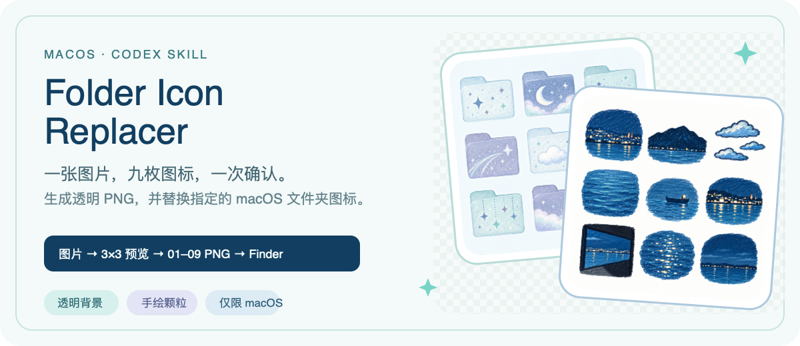

<p align="center">
  
</p>

# Folder Icon Replacer

一个仅限 **macOS** 的 Codex Skill。输入一张图片，它会先判断图片是否有可拆解的视觉元素，再生成编号 `01–09` 的九宫格供你确认。确认后输出九张透明 PNG，并可把其中任意一张设置为指定文件夹的图标。

## 效果预览

同一套流程覆盖两种输入：

- **有可拆解元素**：把主体、局部、物件、动作与场景压缩成 9 个手绘记忆图标。
- **无可拆解元素**：提取主色与气质，生成 9 个同色系文件夹图标。

<p align="center">
  
  
</p>

> 上图使用两张照片作为主题与配色参考生成，用来展示 Skill 的两条设计路线。实际结果会随输入图片、参考图和当前生图模型变化。

## 工作流

```text
接收图片
  ↓
判断是否有可拆解的视觉元素
  ↓
提取 9 个主题，并统一配色与画风
  ↓
生成带 01–09 编号的 3×3 总览图
  ↓
用户确认；只重做不满意的编号
  ↓
生成 01.png–09.png，并检查透明通道、边缘与小尺寸效果
  ↓
交付 PNG；按用户指定的编号替换 macOS 文件夹图标
```

总览未经明确确认时，不会直接生成最终独立图标。替换文件夹前也会再次询问目标路径与编号。

## 安装

### 1. 克隆到 Codex Skills 目录

```sh
git clone https://github.com/cqyu2026/folder-icon-replacer.git \
  "$HOME/.codex/skills/folder-icon-replacer"
```

也可以下载仓库后，将完整的 `folder-icon-replacer` 目录复制到 `~/.codex/skills/`。不要只复制 `SKILL.md`，参考图、说明和脚本都属于 Skill 的一部分。

### 2. 使用

安装后，在 Codex 中上传一张图片并提出请求：

```text
使用 folder-icon-replacer 为这张图片生成一套文件夹图标。
```

你会先收到一张带编号的九宫格。可直接回复：

```text
重做 03 和 07，其他保持不变。
```

全部满意后回复：

```text
确认这套方案，生成 01–09 独立透明 PNG。
```

生成完成后，如需替换文件夹图标：

```text
文件夹路径 /Users/name/Documents/旅行，替换图片 03。
```

每个目标路径与编号都需要明确指定。Skill 不会根据文件名猜测目标文件夹。


当 agent 无法直接写入图标或 macOS 拒绝权限时，可以使用随包脚本：

```sh
/bin/sh /absolute/path/to/folder-icon-replacer/scripts/terminal-apply.sh \
  /absolute/path/to/output/icons/03.png \
  /absolute/path/to/target-folder
```

脚本会先检查 PNG，再通过 macOS `NSWorkspace` 写入并读回验证。它只修改指定文件夹的图标元数据，不遍历或修改文件夹中的普通文件。更多边界与恢复方法见 [`references/apply.md`](./references/apply.md)。


## 3.项目结构

```text
folder-icon-replacer/
├── SKILL.md              # Skill 入口与完整流程
├── assets/               # 元素、文件夹与 README 视觉参考
├── references/           # 设计、交付与 macOS 替换规则
├── scripts/              # PNG 检查与文件夹图标写入
├── tests/
├── VERSION
└── LICENSE
```

## 4.能力边界

- 仅支持 macOS 本机普通文件夹。
- 不处理 App、package、符号链接、挂载点和受保护系统路径。
- 不承诺不同生图模型产生像素一致的结果。
- 脚本检查不能代替对 1024、128、64 px 预览的人工视觉检查。
Skill 不绑定特定生图模型，也不在安装时下载模型或依赖。缺少原生写入能力时，它会给出可复制的终端命令。

## 5.License

[MIT](./LICENSE)
